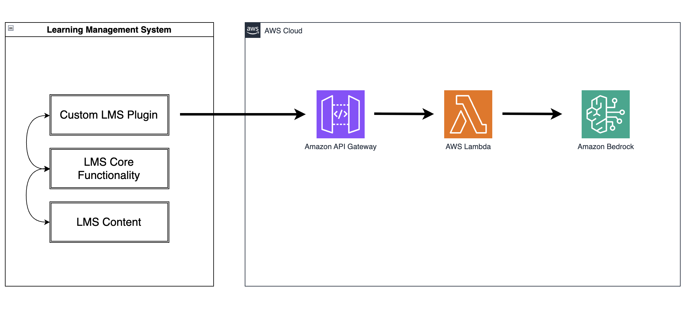
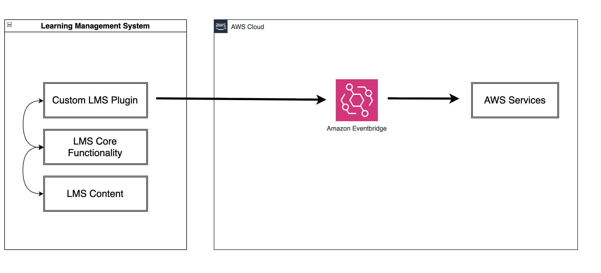
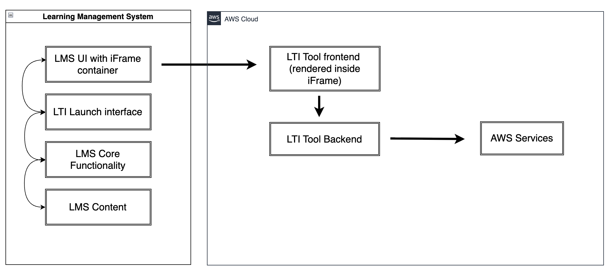

# Sample Moodle Integrations on AWS

> **⚠️ DISCLAIMER**: This is sample code intended for demonstration and non-production use only. Review and adapt security configurations before deploying to production environments.

<!-- This repository provides sample implementations for the patterns described in the [AWS Guidance: Integrating Learning Management Systems (LMS) with AWS](<PLACEHOLDER_URL TODO:>). It demonstrates recommended practices for connecting Moodle with AWS services for a range of use cases. -->

## Overview

This project demonstrates multiple integration patterns for connecting Moodle with AWS:

- **Block Plugin**: AI-powered translation block using Amazon Bedrock 
- **Local Plugin**: Event observer that forwards Moodle events to AWS EventBridge for downstream processing
- **LTI Integration**: Learning Tools Interoperability (LTI) 1.3 integration for embedding AWS services in Moodle courses
- **Web Services API**: REST API integration for automated content indexing with vector embeddings

## Architecture

The solution includes:

- AWS CDK infrastructure (Python) for creating the necessary AWS resources
- React-based LTI frontend as a sample application
- Two Moodle plugins (AWS Events and AI Translator)

## Prerequisites

- Running Moodle instance (non production) 
- Moodle user with sufficient privileges to install plugins
- A standard Moodle user e.g. student

### Required Tools

- [mise](https://mise.jdx.dev/) - Development environment manager
  
  **macOS:**
  ```bash
  # Install mise
  brew install mise
  
  # Activate mise for current terminal session
  eval "$(mise activate bash)"    # for bash
  eval "$(mise activate zsh)"     # for zsh
  ```
  
  **Linux:**
  ```bash
  # Install mise
  curl https://mise.run | sh
  
  # Activate mise for current terminal session
  eval "$(mise activate bash)"    # for bash
  eval "$(mise activate zsh)"     # for zsh
  ```
  
  **Windows:**
  ```powershell
  # Install mise
  winget install jdx.mise
  
  # Activate mise for current PowerShell session
  mise activate pwsh | Out-String | Invoke-Expression
  ```
- Node.js 22 (managed by mise)
- Python 3.13 (managed by mise))
- AWS CLI (managed by mise on Mac and Linux. For Windows see [the installation guide](https://docs.aws.amazon.com/cli/latest/userguide/getting-started-install.html).  This should be configured with appropriate credentials for the deployment account.
- AWS CDK (`npm install -g aws-cdk`)
- [Finch](https://github.com/runfinch/finch) or Docker running for container builds

**For Docker users**: Comment out the CDK_DOCKER line in `mise.toml`:
```toml
# CDK_DOCKER = "finch"
```

### AWS Requirements

1. **AWS Account**: You need a role (or less preferably IAM user) with sufficient permissions to deploy CDK stacks in the chosen region. 

   **Deployment Permissions**: The permissions CloudFormation needs to deploy this stack are defined in the policy templates in [`deployment-policies/`](./deployment-policies/). They were derived from the CloudTrail record of a full deploy and destroy, and grant only the specific actions used, scoped to this account, region and the stack's own resource names. See [Configure CDK Deployment Permissions](#3-configure-cdk-deployment-permissions-optional) for how to create them and use them with `cdk bootstrap`.

## Installation

### 1. Clone and Configure

```bash
git clone https://github.com/aws-samples/sample-moodle-integrations-on-aws.git 
cd sample-moodle-integrations-on-aws
mise trust
```

### 2. Configure Local Settings

**Configure AWS Region:**

Set the AWS region in `mise.local.toml` to match your chosen deployment region. This file holds your personal settings, overrides the defaults in `mise.toml`, and is excluded from git. The following command creates it if it does not exist:
```bash
mise set --file mise.local.toml AWS_REGION="your-preferred-region"
```
This results in the following in `mise.local.toml`:
```toml
[env]
AWS_REGION = "your-preferred-region"
```
If you do not set a region, `mise.toml` defaults to `us-west-2`.

Copy the template and update with your values:

```bash
cp cdk.local.json.template cdk.local.json
```

**Configuration parameters:**

- **domain_name**: The domain name of your Moodle environment without the hostname (e.g., if your Moodle URL was `https://moodle.example.com`, `example.com` should be used). Do not include `https://` or a trailing `/`: the stack builds the Moodle URL from these values, and the LTI launch compares it to the issuer in the token, so `example.com/` fails with an "Invalid issuer" error.
- **host_name**: Subdomain prefix for your Moodle instance (e.g., if your Moodle URL was `https://moodle.example.com`, `moodle` should be used).
- **moodle_role_name**: (Optional) Name of an existing IAM role for AWS-hosted Moodle (e.g., EC2 instance role, ECS task role, or EKS service account role). If provided, the EventBridge policy will be automatically attached to this role. If empty, you must manually configure authentication using IAM Roles Anywhere (recommended) or IAM user with access keys.

**Example for AWS-hosted Moodle:**
```json
{
  "context": {
    "domain_name": "example.com",
    "host_name": "moodle",
    "moodle_role_name": "MyEC2MoodleRole"
  }
}
```

**Example for non-AWS hosted Moodle:**
```json
{
  "context": {
    "domain_name": "example.com",
    "host_name": "moodle",
    "moodle_role_name": ""
  }
}
```

**IAM Permissions:**

The CDK deployment creates a managed IAM policy called `MoodleEventsIAMPolicy` with the minimum permissions required for EventBridge access. The policy configuration depends on your `moodle_role_name` setting:

- **AWS-hosted Moodle (EC2/ECS/EKS)**: If you specified a `moodle_role_name`, the deployment automatically attaches the `MoodleEventsIAMPolicy` to that existing role. Ensure the role name matches your EC2 instance role, ECS task role, or EKS service account role.

- **Non-AWS hosted Moodle**: If you left `moodle_role_name` empty, the `MoodleEventsIAMPolicy` is created but not attached to any role. You must configure authentication manually using one of the following approaches:

  **Option 1: IAM Roles Anywhere (Recommended)**
  
  Use AWS IAM Roles Anywhere to authenticate your Moodle instance without long-lived access keys:
  
  1. Set up IAM Roles Anywhere with your certificate authority
  2. Create an IAM role for IAM Roles Anywhere
  3. Attach the `MoodleEventsIAMPolicy` (created by this deployment) to your IAM Roles Anywhere role
  4. Configure your Moodle server to use the IAM Roles Anywhere credentials
  
  See [AWS IAM Roles Anywhere documentation](https://docs.aws.amazon.com/rolesanywhere/latest/userguide/introduction.html) for detailed setup instructions.

  **Option 2: IAM User with Access Keys (Use Only When Necessary)**
  
  If IAM Roles Anywhere is not feasible, create an IAM user with IP-restricted permissions:
  
  1. **Create an IAM user** (e.g., `MoodleEventsUser`) using the AWS Console or CLI
  2. **Create a custom policy** with IP address restrictions and attach it to your IAM user:
     
     ```json
     {
       "Version": "2012-10-17",
       "Statement": [
         {
           "Effect": "Allow",
           "Action": "events:PutEvents",
           "Resource": "arn:aws:events:REGION:ACCOUNT-ID:event-bus/moodle-events",
           "Condition": {
             "IpAddress": {
               "aws:SourceIp": [
                 "YOUR-MOODLE-SERVER-IP/32",
                 "YOUR-BACKUP-SERVER-IP/32"
               ]
             }
           }
         }
       ]
     }
     ```
     
     > **Note**: Use `/32` for specific IP addresses. If your Moodle environment frequently changes IP addresses (e.g. container based environment), you can use broader CIDR ranges like `192.168.1.0/24` or `10.0.0.0/16` to cover the relevant subnets, but be aware this reduces security by allowing access from a wider range of IP addresses.
  
  3. **Create access keys** for the IAM user and store them securely
  
  **⚠️ Security Requirements for Access Keys:**
  - Store access keys securely
  - Rotate access keys regularly 
  - Monitor access key usage through CloudTrail
  - Never commit access keys to version control
  - **Update IP addresses**: If your Moodle server IP addresses change, update the policy condition accordingly
  
  The IP address restriction in the policy above helps reduce the risk that compromised access keys can be used from outside your authorized Moodle server locations.
  
### 3. Configure CDK Deployment Permissions (Optional)

CDK deployments involve two sets of permissions:

- **Your own credentials** are used by the `cdk` CLI. They only need permission to assume the CDK bootstrap roles (deploy, file publishing and lookup) and read the bootstrap version parameter. They do not make the changes to your account.
- **The CloudFormation execution role** (`cdk-<qualifier>-cfn-exec-role-...`) is created by `cdk bootstrap` and is the identity CloudFormation uses to create the stack's resources. By default, bootstrap attaches the `AdministratorAccess` policy to this role.

For enhanced security, you can attach a least privilege policy to the execution role instead.

#### Default approach:

Do nothing. With no `POLICY_ARN` set, `mise run cdk:bootstrap` attaches `AdministratorAccess` to the CloudFormation execution role, so stack changes run with full administrator permissions regardless of what your own credentials can do.

#### Least privilege approach (recommended for production):

The least privilege permissions are kept as templates in [`deployment-policies/`](deployment-policies/), split into two managed policies (`core` and `services`) to stay under the IAM limit of 6,144 characters per policy. The templates use placeholders for the account ID, region, stack name and bootstrap qualifier, which are filled in when the policies are created. The policies must exist in your account before you bootstrap, because bootstrap attaches them to the CloudFormation execution role.

1. **Create the policies:**
   ```bash
   mise run policy:create
   ```
   This renders the templates into `cdk.out/deployment-policies/`, validates them, then creates IAM policies named `<STACK_NAME>-cdk-deployment-core` and `<STACK_NAME>-cdk-deployment-services`. Their ARNs are saved as a comma-separated `POLICY_ARN` in `mise.local.toml`, which is gitignored. If the policies already exist, for instance after you change a template, the task adds a new default version and removes the oldest version when IAM's limit of 5 is reached.

   Validation (`mise run policy:validate`) fails if a rendered policy is over the size limit, contains a service-wide wildcard action such as `s3:*`, or has errors or security warnings from [IAM Access Analyzer policy validation](https://docs.aws.amazon.com/IAM/latest/UserGuide/access-analyzer-policy-validation.html).

   The task uses your current AWS credentials, which need `sts:GetCallerIdentity`, `access-analyzer:ValidatePolicy`, `iam:GetPolicy`, `iam:CreatePolicy`, `iam:CreatePolicyVersion`, `iam:ListPolicyVersions` and `iam:DeletePolicyVersion`. It runs on macOS and Linux. On Windows, replace the `${...}` placeholders in each template with your values, create each policy with `aws iam create-policy`, and set the ARNs by hand:
   ```bash
   mise set --file mise.local.toml POLICY_ARN="arn:aws:iam::YOUR-ACCOUNT-ID:policy/moodle-plugins-cdk-deployment-core,arn:aws:iam::YOUR-ACCOUNT-ID:policy/moodle-plugins-cdk-deployment-services"
   ```

2. **Bootstrap with them:**
   `mise run cdk:bootstrap` passes `POLICY_ARN` to `--cloudformation-execution-policies`. Running it again on an existing bootstrap stack replaces the attached policies.

**Scope of the policies:**
- Actions are listed individually, with no service-wide wildcards.
- Resources are limited to your account and region, and to names starting with the stack name (`moodle-plugins-*`) wherever the stack controls the name. Bedrock knowledge bases, CloudFront resources, API Gateway APIs and the BucketDeployment layer get generated IDs, so they are scoped to your account and region instead.
- `iam:PassRole` is limited to the stack's roles and to the Lambda and Bedrock services. Managed policy attachments are limited to `AWSLambdaBasicExecutionRole` on the stack's roles and to `MoodleEventsIAMPolicy` on the Moodle role you configure in `moodle_role_name`.
- A few read actions and the CloudWatch Logs resource policy actions don't support resource-level permissions, so they use `Resource: "*"`, restricted to your deployment region and `us-east-1`.

If you add resources to the stack, add the matching permissions to the templates. A missing permission shows up as an `AccessDenied` error from the execution role during `cdk deploy`.

The bootstrap qualifier is set to `moodleplug` (`QUALIFIER` in `mise.toml` and `@aws-cdk/core:bootstrapQualifier` in `cdk.json`, which must match). This gives the sample its own bootstrap stack and execution role, so its least privilege policies don't affect other CDK apps in the same account and region.

**Security Note**: `POLICY_ARN` is attached only to the CloudFormation execution role, which is the role that creates the stack's resources. 

### 4. Initialize and Deploy

```bash
mise run init
mise run cdk:bootstrap
mise run cdk:deploy
mise run package
```

**Important**: Save the outputs from the `cdk:deploy` step, as these URLs and configuration values will be needed later when configuring the Moodle plugins.

## Available Commands

Managed through `mise.toml`, with longer scripts as [file tasks](https://mise.jdx.dev/tasks/file-tasks.html) in `mise-tasks/`:

### Development
- `mise run init` - Install all dependencies
- `mise run clean` - Remove build artifacts

### CDK Operations
- `mise run policy:validate` - Render and validate the least privilege deployment policies
- `mise run policy:create` - Create or update the least privilege deployment policies and save `POLICY_ARN` to `mise.local.toml`
- `mise run cdk:bootstrap` - Bootstrap CDK toolkit (uses `POLICY_ARN` if set)
- `mise run cdk:synth` - Synthesize and check for security issues
- `mise run cdk:deploy` - Deploy stack to AWS
- `mise run cdk:sync` - Watch and hot-reload changes
- `mise run cdk:destroy` - Destroy stack and cleanup

### Build
- `mise run site:build` - Build LTI frontend
- `mise run package` - Package all Moodle plugins
- `mise run events:package` - Package AWS Events plugin only
- `mise run aitranslator:package` - Package AI Translator plugin only

### Security Checks
- `mise run audit` - Run all the checks below and save each one's output to `audit-reports/`. Every check runs even if an earlier one fails.
- `mise run audit:secrets` - Scan git-tracked files for hardcoded secrets (detect-secrets)
- `mise run audit:deps:python` - Check Python dependencies for known vulnerabilities (pip-audit)
- `mise run audit:deps:npm` - Check frontend dependencies for high or critical vulnerabilities (npm audit)
- `mise run audit:sast:python` - Scan Python code for security issues (Bandit)
- `mise run audit:cdk-nag` - Synthesize the CDK app and fail on cdk-nag errors
- `mise run audit:shell` - Lint the shell task scripts (ShellCheck)
- `mise run audit:licenses` - Write third-party license lists to `licenses-python.txt` and `licenses-ts.csv` for review

`mise run init` installs the Python scanners from `requirements-dev.txt`, and `mise install` installs ShellCheck. All of them run locally and don't upload code or results anywhere.

## Production Deployment Considerations

### Custom Domain for CloudFront Distribution

If the sample is being adapted for production deployments, it's strongly recommended to use a custom domain name for the LTI CloudFront distribution instead of the default CloudFront domain. This enables important security configurations:

**Security Benefits:**
- **SSL/TLS Policy Control**: Custom domains allow you to configure minimum SSL/TLS versions (e.g., TLS 1.2 or higher)
- **Certificate Management**: Use your own SSL certificates with proper certificate chains
- **Brand Consistency**: Use your organization's domain for better user trust


> **⚠️ Production Security**: Default CloudFront domains use shared SSL certificates and may not meet enterprise security requirements. Custom domains with proper SSL/TLS policies are essential for production deployments.

## Plugins
The deployment creates two plugin packages:
- `moodle/plugin/local/awsevents.zip` - AWS Events plugin
- `moodle/plugin/blocks/aitranslator.zip` - AI Translator block

### Enable Web Services

Before configuring plugins, enable Moodle's web services. This creates REST API endpoints that allow AWS services to authenticate and access Moodle resources. Specifically, this is required for:

- **AI Translator block**: User authentication via Moodle web service tokens
- **AWS Events plugin**: File indexing capabilities that allow AWS Lambda functions to retrieve course content and files from Moodle

1. Enable web services: Site Administration > Server > Web services > Overview
1. Enable REST protocol: Site Administration > Server > Web services > Manage protocols

> **⚠️ Security Note**: If web services are not currently enabled in your Moodle environment, make sure that you understand the risks of enabling these options and that you have appropriate controls and firewall rules in place to avoid unintended access to your Moodle environment. Web services create API endpoints that, if not properly secured, could expose sensitive data or functionality.

### AI Translator Block

#### Architecture

The block plugin follows the following architecture to integerate with the Moodle LMS.



The Moodle plugin calls an API Gateway endpoint backed by a Lambda function. It makes a POST request to interact with the Bedrock service. 

1. Custom LMS Plugin Component: Native extension to the LMS that provides the UI and handles user interaction.

2. API Gateway: Secure endpoint that receives requests from the plugin.

3. AWS Lambda: Processes requests, formats prompts for the model, and handles responses.

4. Amazon Bedrock: Provides access to foundation models like Claude or Amazon Nova.

#### Installation

Install the AI Translator block by navigating to Site Administration > Plugins > Install plugins and uploading the zip file.

#### Configure API Gateway

1. If not automatically redirected to the configuration page, navigate to: Site Administration > Plugins > Blocks > AI Translator
1. Configure:
   - **API Gateway URL**: The CloudFormation stack output starting with `MoodleAiTranslatorTranslateEndpoint` (e.g., `https://abc123.execute-api.us-west-2.amazonaws.com/v1/translate`)

#### Configure User Permissions

Create a custom role and external service for users who should have access to the AI Translator:

1. Create custom role: Site Administration > Users > Permissions > Define roles
   - Click `Add a new role`
   - Use role or archetype: `No role`
   - Short name: `aitranslatorrole`
   - Custom full name: `AI Translator Role`
   - Context types where this role may be assigned: `System`
   - Filter capabilities and allow:
     - `webservice/rest:use`
     - `moodle/webservice:createtoken`
   - Click `Create this role`
1. Assign role to users: Site Administration > Users > Permissions > Assign system roles
   - Select `AI Translator Role`
   - Add users who should have access to the translator e.g. a student user (not the Moodle administrator)
1. Create external service: Site Administration > Server > Web services > External services
   - Click `Add`
   - Name: `AI Translator Service`
   - **Short name: `ai_translator`** (⚠️ IMPORTANT: Must be exactly `ai_translator` - this is referenced from the plugin)
   - Enabled: ✓
   - Authorized users only: ✓
   - Click `Add service`
   - Click `Add functions`
   - Add function: `core_webservice_get_site_info`
   - Click `Add functions`
1. Authorize users: Site Administration > Server > Web services > External services
   - Click `Authorised users` for AI Translator Service
   - Add users who should have access e.g. a student user (not the Moodle administrator)

> **Note**: The `core_webservice_get_site_info` function is required for API Gateway authorization. This role grants only the minimum permissions required for the AI Translator to function, following the principle of least privilege.

#### Add Block to Course

1. Navigate to a course where you want to add the AI Translator block
1. Turn editing on
1. Click `Add a block` in the sidebar
1. Select `AI Translator`
1. The block will appear in the sidebar

#### Test Translation

1. Ensure you are logged in to Moodle with a user who has been authorized e.g. a student user (not the Moodle administrator)
1. In the AI Translator block, enter text in the input field
1. Click `Ask AI`
1. The translated text will appear below

**Verification:**

The block uses the user's Moodle web service token to authenticate with API Gateway, which validates the token against Moodle's web service API before invoking the translation Lambda function backed by Amazon Bedrock. Check CloudWatch Logs for the translate Lambda function to verify API calls.

> **Note**: Unlike the AWS Events plugin (below) which uses service credentials, the AI Translator block operates in the user's context. Each translation request is authenticated using a Moodle web service token generated for the logged-in user, ensuring user-level access control.

### AWS Events Plugin

#### Architecture

The events plugin follows the following architecture to integrate with the Moodle LMS.



When an event occurs in the LMS, the following process takes place:

1. LMS captures the event in its Events subsystem

2. Custom LMS Plugin observes each created event

3. The plugin sends an authenticated request to EventBridge or streaming service with the event payload

3. AWS API validates the request using IAM

3. Upon successful authentication, the request is added to an EventBridge event bus or stream

3. A rule receives incoming events and routes them to appropriate AWS Services based on matching event patterns or records are processed off the stream and processed by the consumer.

This architecture is designed to help secure communication between the LMS and AWS Services, allowing LMS platform capabilities to be extended with AWS Services.

#### Installation

Install the AWS Events plugin by navigating to Site Administration > Plugins > Install plugins and uploading the zip file.

> **Note**: The AWS Events plugin depends on the [local_aws plugin](https://moodle.org/plugins/local_aws) for AWS SDK support. You will be given the option to install this during the installation if not already installed.

#### Configure Event Forwarding

1. If not automatically redirected to the configuration page, navigate to: Site Administration > Plugins > Local plugins > AWS Events
2. Configure based on your authentication method:

**For AWS-hosted Moodle or IAM Roles Anywhere:**
- **AWS Authentication Method**: EC2 Instance Role
- **AWS Region**: Your deployment region (e.g., us-west-2)
- **Event Bus Name**: `moodle-events`

> **Note**: This configuration works for both AWS-hosted Moodle (EC2/ECS/EKS with `moodle_role_name` specified) and non-AWS hosted Moodle using IAM Roles Anywhere. IAM Roles Anywhere provides temporary credentials through the AWS credential chain, so the plugin treats it the same as an EC2 instance role.

**For non-AWS hosted Moodle with Access Keys (use only when necessary):**
- **AWS Authentication Method**: Access Keys
- **AWS Region**: Your deployment region (e.g., us-west-2)
- **AWS Access Key**: Your IAM user access key
- **AWS Secret Key**: Your IAM user secret key
- **Event Bus Name**: `moodle-events`

> **Security Note**: If using access keys, ensure they are stored securely, rotated regularly , and monitored through CloudTrail. Consider migrating to IAM Roles Anywhere for improved security. 

#### Configure Web Service API

Required for file indexing:

1. Create API user: Site Administration > Server > Web services > Create a specific user
   - Username: `index_files_api_user`
   - Password: Random password (doesn't need to be used again)
   - First name: `API`
   - Last name: `IndexFiles`
   - Email: unique email address
1. Create custom role: Site Administration > Users > Permissions > Define roles
   - Click `Add a new role`
   - Use role or archetype: `No role`
   - Short name: `webservicefileaccessrole`
   - Custom full name: `Web Service File Access Role`
   - Context types where this role may be assigned: `System`
   - Filter capabilities and allow:
     - `webservice/rest:use`
     - `moodle/course:view`
     - `moodle/course:viewhiddencourses`
   - Click `Create this role`
1. Assign role to user: Site Administration > Users > Permissions > Assign system roles
   - Select `Web Service File Access Role`
   - Add `API IndexFiles` user
1. Create external service: Site Administration > Server > Web services > External services
   - Click `Add`
   - Name: `Index Files Service`
   - Short name: `index_files`
   - Enabled: ✓
   - Authorized users only: ✓
   - Can download files: ✓
   - Click `Add Service`
   - Add function: 
      - Name: `core_course_get_contents`
      - Click `Add functions`
   - Authorize user: Site Administration > Server > Web services > External services
       - Select `Authorised users` against the IndexFiles service
       - Add the user `API IndexFiles` as an Authorised user
1. Create token: Site Administration > Server > Web services > Manage tokens
   - Click `Create token`
   - User: `API IndexFiles`
   - Service: `IndexFiles`
   - Valid until: unticked
1. In AWS Secrets Manager update the Secret value of the secret named `moodle-plugins/moodle/token` (`<STACK_NAME>/moodle/token` if you changed `STACK_NAME`) with the Token just generated

**Verification:**

After configuration, uploading a file to a Moodle course triggers a Lambda function that indexes it in the Bedrock Knowledge Base. Verify by checking the `moodle-plugins-MoodleDataSource` data source under the `moodle-plugins-MoodleFiles` Knowledge Base in the AWS Console.

## Sample LTI Tool

### Architecture

The LTI tool follows the following architecture and flow to integrate with Moodle.



When a user interacts with the LTI plugin in the LMS:

1. The LMS and the LTI tool perform a handshake process that enables the exchange of information.

1. Upon success, the LTI tool is displayed inside an iFrame on the LMS.

1. The tool makes authenticated calls to an AWS backend.

1. The tool returns the requested information.

1. Alternatively, the tool can also pass information back to the LMS.

### Configure the Learning tools interoperability (LTI) tool

1. Configure the LTI tool: Site Administration > Plugins > Activity modules > Manage tools > Configure a tool manually
1. Enter details. Make sure to select LTI version as **LTI 1.3**. The **Tool URL**, **Public keyset**, and **Initiate login URL** can be found in the CloudFormation stack outputs

| Tool Parameter | Description | Cloudformation output |
|----------------|-------------|---------|
| Tool name | The name of the tool | N/A
| LTI Version | The version of LTI being used for signing messages and service requests should be set to LTI 1.3 | N/A |
| Tool URL | The URL of your tool's launch endpoint | LTIToolURL |
| Public keyset | The URL of an endpoint which will return a public key | LTIPublicKeyset |
| Initiate login URL | The URL of your tool's login endpoint | LTIInitiateLoginURL |
| Redirect URI (s) | List of URI (s) that Moodle can redirect to. You would usually add here at least your launch URI as Moodle redirects there as part of the handshake process | N/A |

1. Once the tool is created, you can click on the magnifiying glass icon to view the parameters generated by Moodle. Copy the **ClientID**.
1. On the AWS console, visit the Parameter store in the region where Moodle was deployed.
1. Modify the **/lti/client-id** parameter with the one copied above.
1. Back in Moodle, go to the course where you want to add the LTI tool
1. Enable the tool in the activity chooser: More > LTI External Tools > Show in activity chooser
1. Your tool should be available as an activity to add to a course.

> **Note**: This LTI tool is a sample implementation intended for demonstration purposes only. It demonstrates the LTI 1.3 authentication flow and integration patterns but does not provide functionality. Use this as a reference for building functional LTI tools.

## Project Structure

```
.
├── cdk/                    # CDK infrastructure code
│   ├── constructs/         # Reusable CDK constructs
│   └── cdk_stack.py        # Main stack definition
├── lambda/                 # Lambda function code
│   ├── index_moodle_file/  # File indexing
│   ├── lti/                # LTI integration
│   ├── moodle_authorizer/  # API Gateway authorizer
│   └── translate/          # Translation service
├── lti_frontend/           # React LTI frontend
├── moodle/plugin/          # Moodle plugins
│   ├── blocks/             # AI Translator block
│   └── local/              # AWS Events local plugin
├── layers/                 # Lambda layers
├── deployment-policies/    # Least privilege CloudFormation execution policy templates
├── app.py                  # CDK app entry point
├── cdk.json                # CDK configuration
├── mise-tasks/             # Longer mise task scripts (Windows variants as .cmd)
└── mise.toml               # Task runner configuration
```

## Cleanup

To remove all deployed AWS resources:

```bash
mise run cdk:destroy
```

This command will:
- Delete the CloudFormation stack and all associated resources
- Remove Lambda functions, API Gateway, EventBridge bus and S3 Vectors bucket
- Clean up CloudWatch log groups

> **Note**: Some resources may incur costs until fully deleted. Verify deletion in the AWS Console.
